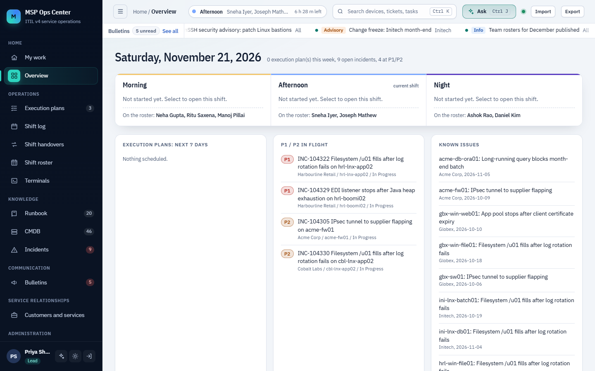
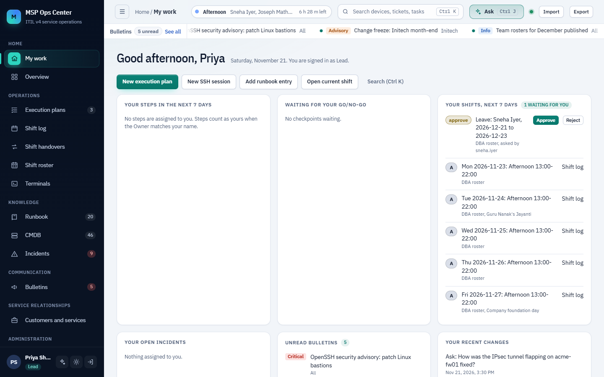
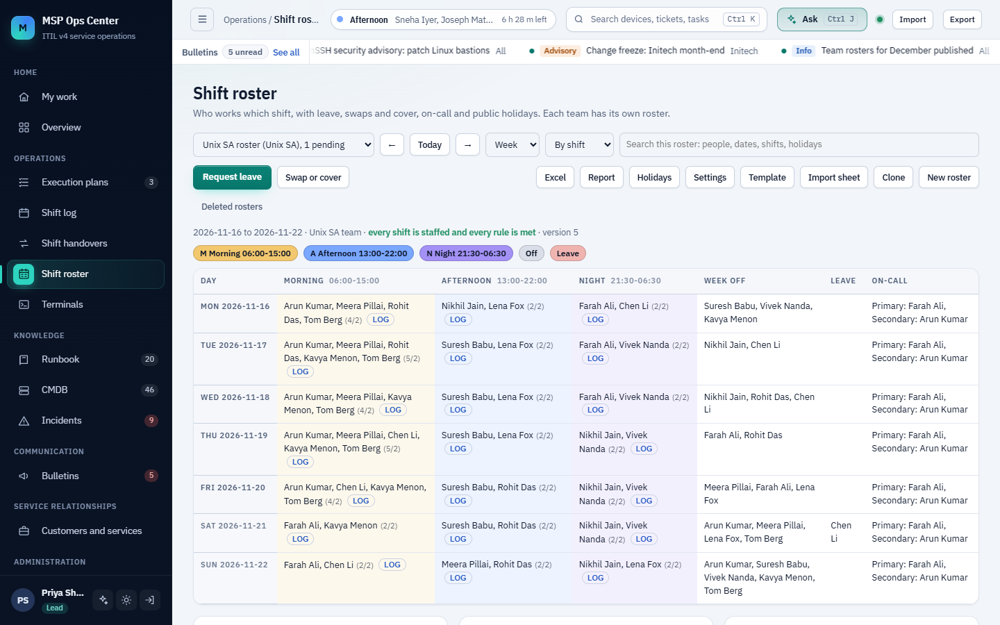
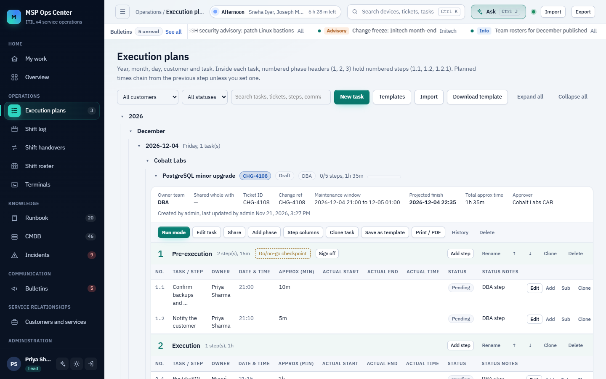
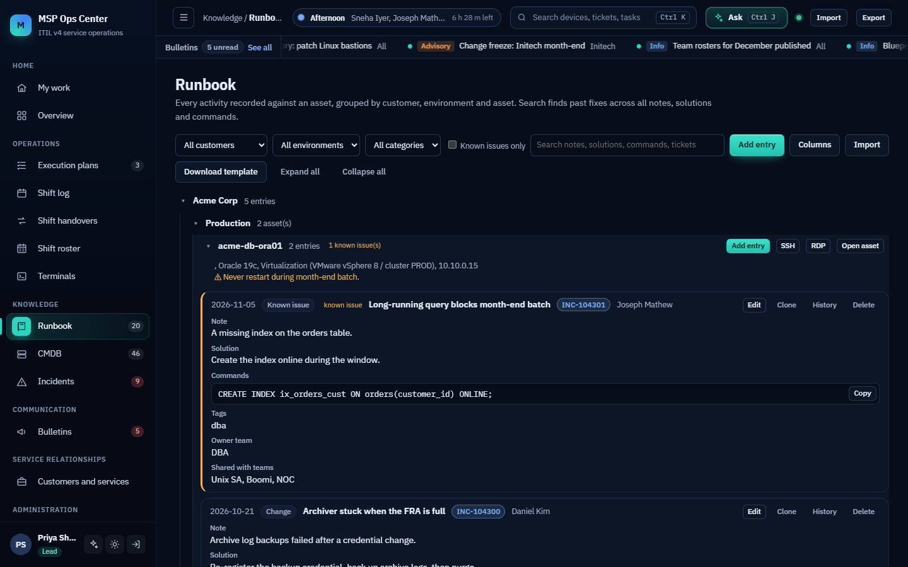
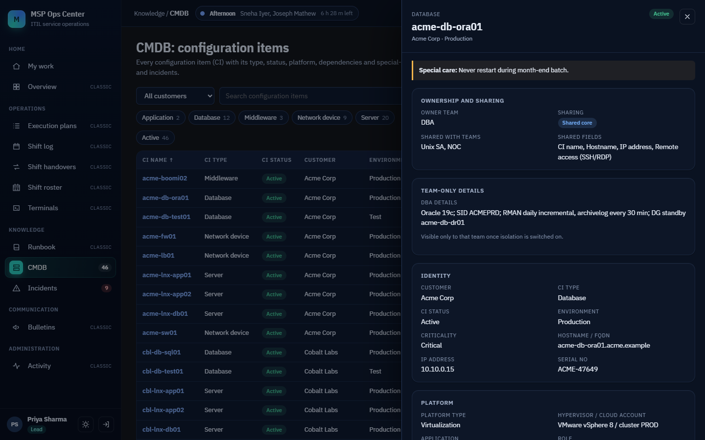
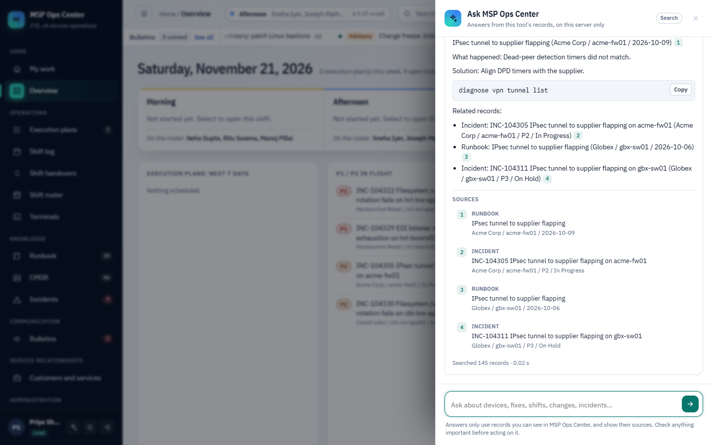
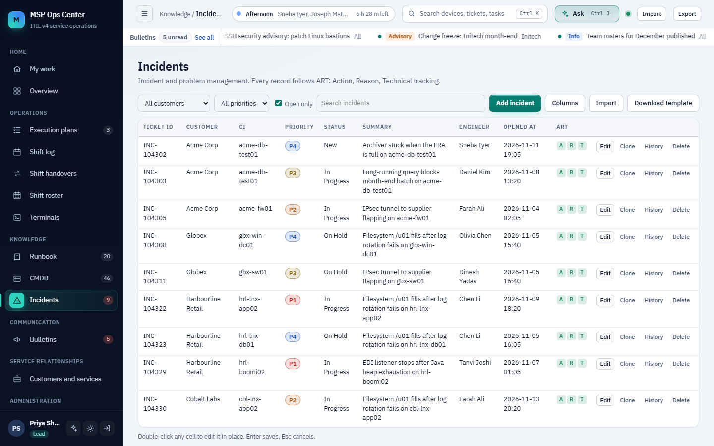
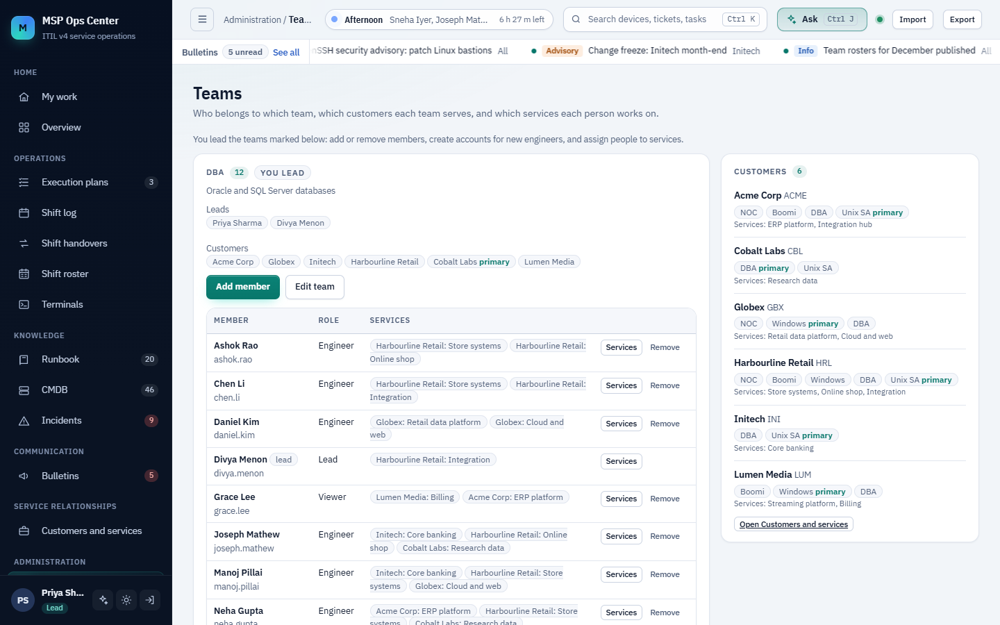
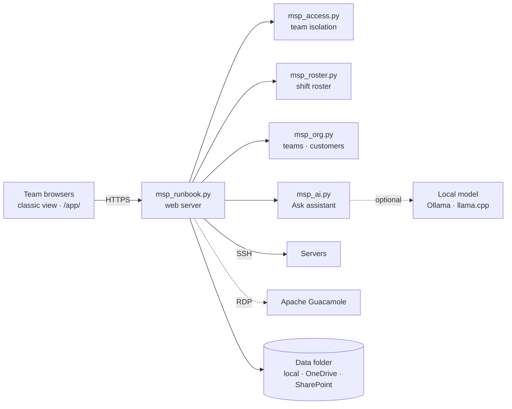

<div align="center">

# MSP Ops Center

**One browser portal where an MSP operations team keeps its execution plans, runbooks, CMDB, incidents, shift logs, rosters and terminals, all on its own server.**

[](#requirements)
[](https://www.python.org/downloads/windows/)
[](#features)
[](#self-tests)
[](LICENSE)

[Quick start](#quick-start) · [Features](#features) · [Screenshots](#screenshots) · [Try the demo](#try-the-demo) · [Settings](#settings) · [Security](#security)

<picture>
  <source media="(prefers-color-scheme: dark)" srcset="docs/images/overview_dark.png">
  
</picture>

</div>

---

## Why MSP Ops Center?

- **One place for the whole shift.** Plans, runbooks, the CMDB, incidents, handovers, the roster and bulletins live together, so the person on shift does not hunt through spreadsheets, wikis and chat.
- **Runs on one PC or server.** It is a single Python program with no database server. The whole team uses it in the browser. Data stays in a local folder, a OneDrive-synced SharePoint folder, or a SharePoint library.
- **Excel in, Excel out.** Every page has a download template and an import, so existing spreadsheets move in on day one and exports open in Excel.
- **Teams see their own data.** Each team owns its CIs, runbook entries, shift log and handovers, and chooses what it shares with other teams serving the same customer.

## Features

| | |
|---|---|
| 🗓 **Execution plans** | Year › month › day › customer › task, with numbered phases and steps, chained planned times, go/no-go checkpoints, rollback, run mode, templates and a print view. |
| 📘 **Runbook** | Every fix recorded against an asset, grouped by customer, environment and asset. Known issues, commands with a copy button, and search across notes, solutions and tickets. |
| 🗄 **CMDB** | A full record per configuration item: type, platform, sizing, dependencies, "special care" warnings and team-only details. Device names link to the runbook. |
| 🚨 **Incidents** | P1–P4 tickets in the ART format (Action, Reason, Technical tracking), with history and in-place editing. |
| 🔁 **Shift log & handovers** | Year › month › day › shift with seven standard handover sections. Rows can carry forward from the previous shift, and whole shifts can be cloned. |
| 👥 **Shift roster** | Daily to monthly cycles, rotations, rest-hour and sequence rules, leave, swaps and cover with Lead approval, on-call rotas, escalation, public holidays and Excel export. |
| 💻 **Terminals** | One-click SSH in the browser (recorded for admins) and RDP through a `.rdp` file or Apache Guacamole. |
| 🤖 **Ask assistant** | Answers questions from the portal's own records, with numbered sources. Works with no AI model, or words answers with a local Ollama or OpenAI-compatible model on your network. |
| 📣 **Bulletins** | A scrolling ticker with Critical / Advisory / Info levels and read receipts. |
| 🏢 **Teams & customers** | Customers, services, teams and leads, the teams serving each customer, a primary team per customer, and who works on which service. |
| 🔒 **Security** | Local logins and/or Microsoft 365 sign-in, server-enforced roles (Viewer, Engineer, Lead, Admin), CSRF protection, lockout, idle timeout, optional HTTPS and an audit trail. |
| 🌗 **Modern UI** | Light and dark themes, Ctrl K search, Ctrl J to ask, and a new React interface at `/app/` that is replacing the classic screens one by one. |

## Screenshots

| My work: your steps, shifts and approvals | Shift roster with on-call and coverage |
|---|---|
|  |  |
| **Execution plan with phases and a go/no-go checkpoint** | **Runbook: past fixes with commands** |
|  |  |
| **CMDB detail: special care, sharing and team-only notes** | **Ask assistant with numbered sources** |
|  |  |
| **Incidents in the ART format** | **Teams, customers and services** |
|  |  |

> All screenshots use the made-up demo data from `Demo_Data`. Every page also has a dark version in [`docs/images`](docs/images).

## Quick start

1. **Install Python 3.12** (3.11 to 3.14 work) from [python.org](https://www.python.org/downloads/windows/) and tick **"Add Python to PATH"**.
2. **Download this repository.** Click **Code → Download ZIP** and unzip it, or clone it:
   ```powershell
   git clone https://github.com/swainamar/MSP_Ops_Center.git
   ```
3. **Double-click `MSP_Ops_Center\Start_MSP_Ops_Center.bat`.** The first start creates a private Python environment, installs the packages and writes `msp_settings.ini`. Keep the window open while people use the portal.
4. The browser opens at **http://127.0.0.1:8080** with the demo already loaded (see [Try the demo](#try-the-demo)).

To let the whole team connect, set `host = 0.0.0.0` in `msp_settings.ini` and, ideally, add an HTTPS certificate (see [Settings](#settings)).

## Try the demo

The repository ships with a ready-made demo in `MSP_Ops_Center\msp_data`: five teams (Unix SA, Windows, DBA, Boomi, NOC), six customers, CMDB items, runbook entries, incidents, plans, shift logs and rosters. All people, companies, hosts and tickets in it are made up.

Sign in as `admin`, `priya.sharma` (DBA lead), `anjali.nair` (NOC lead), `rahul.verma` (engineer) or `tom.berg` (read-only operator). Every demo account uses the password `Demo-Ops-2026!`. `Demo_Data\09_Demo_Logins_and_Teams.xlsx` lists all of them.

To rebuild the demo in a fresh copy, empty `msp_data` and run `Start_MSP_Ops_Center.bat` once, then `Load_Demo_Data.bat`.

## Use it for real

The demo password is public, so **never run a live installation on the demo data.** Before the first real start, delete everything in `MSP_Ops_Center\msp_data`. The first visit then asks you to create your own administrator account, and you import your own data from Excel with each page's **Download template** and **Import**.

## Requirements

| | Minimum | Recommended |
|---|---|---|
| OS | Windows 10 (64-bit) | Windows 11 or Windows Server |
| Python | 3.11 | 3.12 |
| Browser | Any current Edge, Chrome or Firefox | |
| Packages | `openpyxl`, `paramiko`, `cryptography`, `defusedxml`, `holidays`: installed automatically from `requirements.txt` with exact versions and SHA-256 hashes | |
| Optional | | Apache Guacamole for in-browser RDP · Ollama or another local model for worded assistant answers · Node.js only to rebuild the `/app/` interface |

## How it works



The data folder holds:

| File | Contents |
|---|---|
| `msp_runbook_data.xlsx` | Assets (CMDB), runbook, incidents, handovers, bulletins, audit trail |
| `msp_execution_plans.json` | Execution plans and plan templates |
| `msp_shift_hierarchy.json` | Shift log tree |
| `msp_roster.json` | Rosters, leave, swaps and on-call |
| `msp_org.json` | Teams, customers, services and assignments |
| `msp_users.json` | Users, roles, password hashes and trusted SSH host keys |
| `msp_metadata.json` | Version history, import batches, read receipts, terminal session index |
| `backups/` | Automatic daily JSON backups |

Every change is saved with optimistic concurrency, so two people editing the same record cannot overwrite each other, and earlier versions can be restored from **History**.

## Settings

Edit `MSP_Ops_Center\msp_settings.ini` in Notepad, then restart `Start_MSP_Ops_Center.bat`.

| Section | What it sets |
|---|---|
| `[server]` | Host and port, browser auto-open, public URL, HTTPS certificate and key, trusted proxy headers, allowed frame ancestors |
| `[storage]` | `local` folder or `sharepoint` library through Microsoft Graph |
| `[signin]` | Microsoft 365 (Entra ID) sign-in alongside local logins |
| `[guacamole]` | URL, JSON secret key and recording path for in-browser RDP |

## Repository layout

```
MSP_Ops_Center/
├── Start_MSP_Ops_Center.bat   launcher: environment, packages, settings, server
├── Load_Demo_Data.bat         loads the demo into a demo copy
├── Run_Self_Tests.bat         runs every test suite
├── msp_runbook.py             web server and classic interface
├── msp_access.py              who may see or change team data
├── msp_roster.py              shift roster
├── msp_org.py                 teams, customers and services
├── msp_ai.py, msp_ai_*.py     Ask assistant and its how-to guides
├── msp_demo.py, msp_demo_data.py
├── test_msp_*.py              unit tests
├── Demo_Data/                 demo spreadsheets
├── frontend/                  React + TypeScript source of /app/ (Vite)
└── static/                    fonts, xterm.js and the built /app/ interface
docs/images/                   README screenshots
```

## Self tests

Double-click `Run_Self_Tests.bat`, or run one suite directly:

```powershell
cd MSP_Ops_Center
.venv\Scripts\python.exe -m unittest -v test_msp_runbook.py
```

## Security

- **Keep `msp_settings.ini` private.** It can hold client secrets and the Guacamole key. Do not commit a filled-in copy.
- Use HTTPS (`tls_cert`, `tls_key`) whenever `host = 0.0.0.0`.
- Enable `trust_proxy_headers` only behind Azure App Service sign-in or a reverse proxy that sets and strips identity headers.
- Demo accounts share a published password. Never use the demo data for a live installation, and never commit a live `msp_data` folder: it holds password hashes and personal details.
- Packages install only with `--require-hashes`, so a tampered or unexpected package is refused.
- Administrators belong to no team, so they see no team data (separation of duties). Terminal session recordings are visible to administrators only.

## License

[MIT](LICENSE). The bundled fonts (IBM Plex) and xterm.js keep their own licenses; see [`static/THIRD_PARTY_LICENSES.txt`](MSP_Ops_Center/static/THIRD_PARTY_LICENSES.txt).
